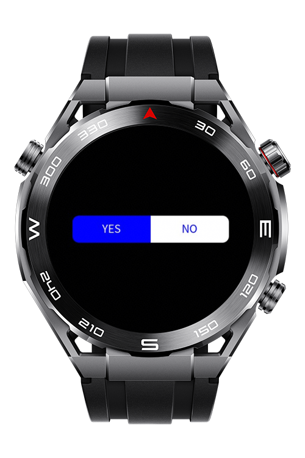
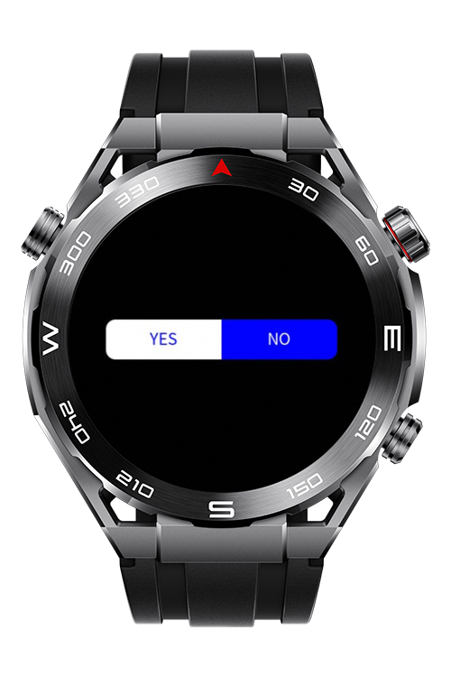

> **Note:** To access all shared projects, get information about environment setup, and view other guides, please visit [Explore-In-HMOS-Wearable Index](https://github.com/Explore-In-HMOS-Wearable/hmos-index).

# How To Create Selection Button

This app shows how to create a selection button with two options.

# Preview

<div>
  
  
</div>

# Use Cases

- Implement a selection button with two options.

# Technology

## Stack

- **Languages**: HML, JS
- **Frameworks**: 4.0.0(10)
- **Tools**: DevEco Studio Version 6.0.1.251

# Directory Structure

```
entry/src/main/js/MainAbility
│   app.js
│
└───pages
    └───index
            index.css
            index.hml
            index.js
```

# Constraints and Restrictions

## Supported Device

- Huawei Sport (Lite) Watch GT 4/5/6
- Huawei Sport (Lite) GT4/5 Pro
- Huawei Sport (Lite) Fit 3/4
- Huawei Sport (Lite) D2
- Huawei Sport (Lite) Ultimate

# License

**How To Create Selection Button** is distributed under the terms of the MIT License
See the [LICENSE](./LICENSE) for more information.